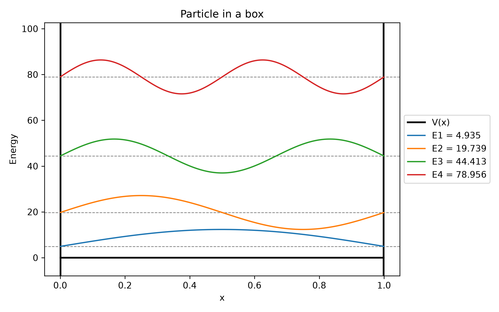
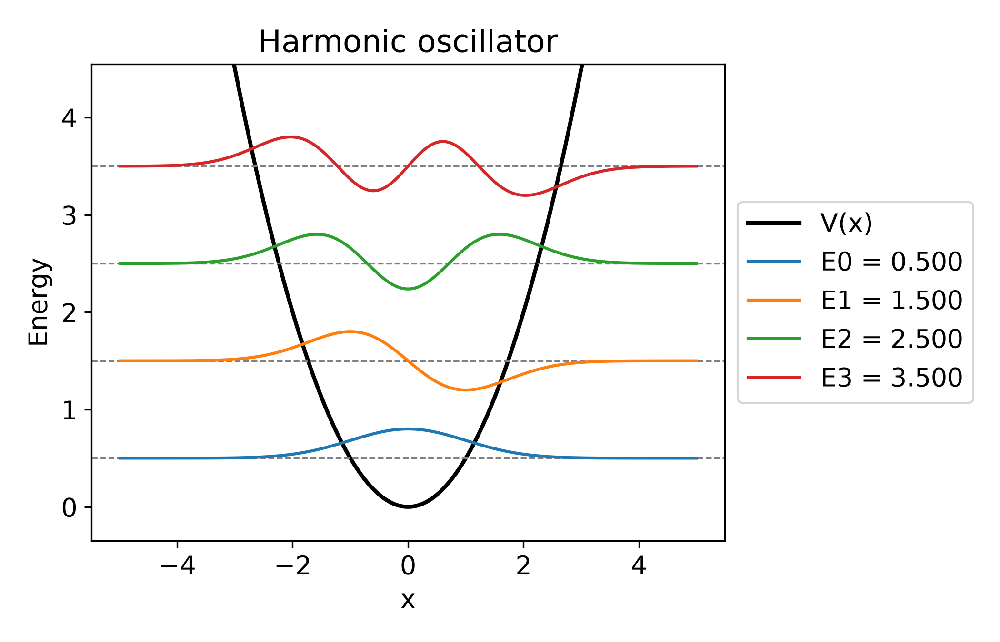
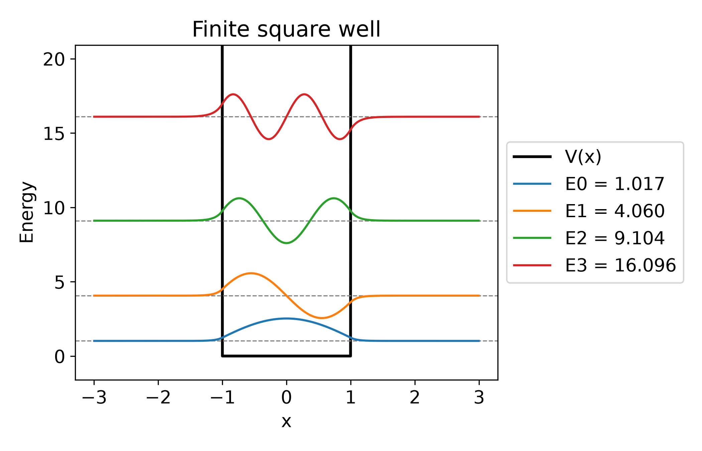
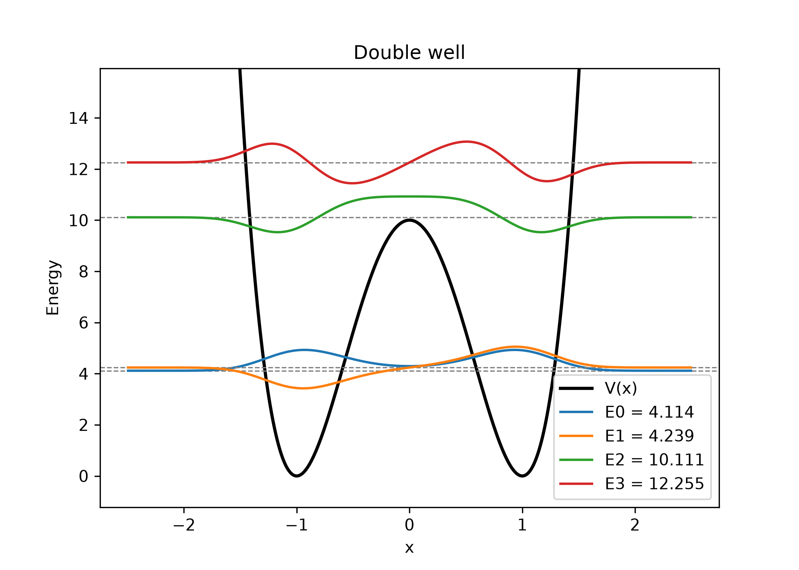

# Schrödinger Solver

A Python tool that solves the **1D time-independent Schrödinger equation** numerically
for any potential V(x), and plots the energy levels and wavefunctions.

## Physics motivation

In quantum mechanics, a particle in a potential V(x) can only have certain energies.
These energies and the wavefunctions come from the Schrödinger equation
(units: ħ = m = 1):

$$-\frac{1}{2}\frac{d^2\psi}{dx^2} + V(x)\psi = E\psi$$

Only a few potentials (box, harmonic oscillator) can be solved exactly by hand.
For realistic potentials, like a finite well or a double well, we need a numerical method.

## Numerical method

1. Space is divided into N grid points with spacing dx.
2. The second derivative is replaced by the finite-difference formula

$$\frac{d^2\psi}{dx^2} \approx \frac{\psi_{i+1} - 2\psi_i + \psi_{i-1}}{dx^2}$$

3. The equation becomes a matrix eigenvalue problem **Hψ = Eψ**, where H is tridiagonal.
4. The eigenvalues of H are the energies, and the eigenvectors are the wavefunctions.
5. Boundary condition: ψ = 0 at both ends of the region.

## Project structure

```
schrodinger-solver/
├── src/
│   ├── solver.py        # builds the matrix H and finds energies and wavefunctions
│   ├── potentials.py    # box, harmonic oscillator, finite well, double well
│   └── plotting.py      # draws the potential, energy levels and wavefunctions
├── examples/
│   └── run_examples.py  # runs all four potentials and saves the figures
├── tests/
│   └── test_validation.py   # validation tests against exact answers
├── figures/             # saved figures
├── docs/                # extra documentation
├── report/              # technical report
└── requirements.txt     # required Python libraries
```

## Installation

You need Python 3. Then run:

```
git clone https://github.com/poojakalal-code/schrodinger-solver.git
cd schrodinger-solver
pip install -r requirements.txt
```

## Example usage

Run all examples (prints the energies and saves the figures in `figures/`):

```
python examples/run_examples.py
```

Use the solver in your own code:

```python
import sys
sys.path.insert(0, "src")

from solver import solve
from potentials import harmonic

x, E, psi = solve(harmonic, -5, 5, N=1000, n_states=4)
print(E)    # [0.5  1.5  2.5  3.5]
```

You can also use your own potential:

```python
x, E, psi = solve(lambda x: 0.1 * x**4, -6, 6)
```

## Results

| Particle in a box | Harmonic oscillator |
|---|---|
|  |  |

| Finite square well | Double well |
|---|---|
|  |  |

**Comparison with exact answers**

| State | Box (numerical) | Box (exact n²π²/2) | Harmonic (numerical) | Harmonic (exact n + ½) |
|---|---|---|---|---|
| 1st | 4.934798 | 4.934802 | 0.499997 | 0.5 |
| 2nd | 19.739144 | 19.739209 | 1.499984 | 1.5 |
| 3rd | 44.412892 | 44.413220 | 2.499960 | 2.5 |
| 4th | 78.955798 | 78.956835 | 3.499923 | 3.5 |

**Observations**
- Finite well: all energies are lower than for an infinite well of the same width,
  because the wavefunction leaks into the walls.
- Double well: the two lowest levels form a close pair (E1 − E0 ≈ 0.125).
  This splitting is caused by quantum tunneling through the middle barrier.

## Validation tests

Run all tests with:

```
python -m pytest -v
```

| Test | What it checks |
|---|---|
| `test_box_energies` | Box energies match n²π²/2 |
| `test_harmonic_energies` | Oscillator energies match n + ½ |
| `test_normalization` | Total probability ∫\|ψ\|² dx = 1 |
| `test_convergence` | More grid points give a smaller error |

## Dependencies

- numpy
- scipy
- matplotlib
- pytest

## Author

Pooja Kalal, Computational Methods for Physics, Wichita State University

## License

MIT License